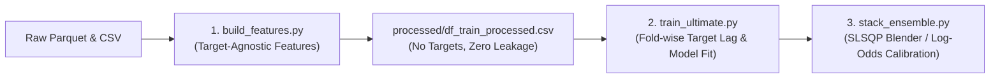

# 🗺️ Master Plan & Work Instructions (DACON ETRI Human Understanding)

This document is the master specification that guides the machine learning engineering pipeline, validation strategy, domain knowledge integration, and operational guidelines for the DACON ETRI Human Daily Experience Understanding Challenge.

---

## 1. 🏗️ Project Architecture & Decoupled Directory Structure

To maintain 100% leak-free processing and ensure clean code portability, the project is structured as follows:

```text
/dacon-etri-human-understanding/
├── data/                              # Data Directory [Strict Portability Lock 🟢]
│   ├── raw/                           # Original Competition Data
│   └── processed/                     # Refined Feature Cache Store
│
├── docs/                              # Project Documentation
│   ├── MASTER_PLAN.md                 # [THIS FILE] Master plan and evolution roadmap
│   ├── submissions/submission_log.csv # Single source of truth for submission history
│   ├── domain/                        # 🧪 Clinical & Physiological Sleep Domain Specs
│   │   ├── etri_lifelog_2024_paper.pdf # Official ETRI Lifelog academic paper
│   │   ├── withings_sleep_analyzer_spec_ko.md # Withings hardware & metrics spec (KOR)
│   │   └── nsf_sleep_guidelines_ko.md  # NSF Sleep Quality consensus indicators (KOR)
│   └── competition/                   # 🏆 Official Dacon Specs & Metrics
│       ├── DATA_DICTIONARY.md         # Full feature mapping specs
│       └── ch2026_metrics_description.md # 2026 metrics definition guide
│
├── src/                               # Decoupled Modules
│   ├── data/                          # raw data loaders
│   ├── features/                      # leak-free feature extraction
│   └── utils/                         # CV fold generator, probability clippers
│
├── notebooks/                         # Interactive Development
│   └── core/                          # Consolidated SOTA scripts (v31 Ultimate)
│
└── scripts/                           # Production scripts and ensembles
```

---

## 2. 🚨 The Root Problem: Target Leakage & The Interleaved Split

The primary bottleneck in previous baseline configurations (bottlenecking the LB score at `0.60` ~ `0.62`) was the **Validation Strategy Mismatch** and **Covariate Shift** induced by Look-Ahead Target Leakage.

### 2.1. Chronological Interleaved Block Split
- The competition organizers split the dataset into Train and Test sets per subject based on interleaved time blocks.
- **Visual Flow**: `[Train Block 1]` ➡️ `[Test Block 1 (Hole)]` ➡️ `[Train Block 2]` ➡️ `[Test Block 2 (Hole)]`
- Because the evaluation points (Holes) are nestled between training windows, calculating chronological lag features (e.g. `target_prev`, `target_interp`) for the test/validation set requires retrieving labels from both surrounding training blocks.
- **The Bug**: Prior code versions either (a) failed to supply training labels during test feature calculation, leading to constant `0.5` flat-lines (Covariate Shift), or (b) blindly computed lags globally across all rows before splitting, leaking validation targets directly into the training subset (**Look-Ahead Target Leakage**).

### 2.2. Validation Strategy: Subject-Hole CV (`make_subject_hole_folds`)
To accurately emulate the test set without leaking labels, we implement a custom validation generator inside [validation.py](file:///Volumes/samsd/workspace_v2/dacon/dacon-etri-human-understanding/src/utils/validation.py):
1.  **Temporal Sorting**: Sort each subject's timeline chronologically by `sleep_date`.
2.  **Partitioning**: Divide each subject's records into $2 \times N_{\text{folds}}$ chronological blocks (e.g., 10 blocks for 5-fold CV).
3.  **Hole Simulation**: For each fold, designate specific inner blocks (e.g., Block 0 and Block 5) as the validation set, leaving the remaining interleaved blocks for training.
4.  **No-Leak Lag Propagation**: Lag features are constructed strictly fold-wise. Information is propagated forward only; backward propagation (`bfill`) is completely prohibited.

---

## 3. 🛡️ Architectural Decoupling: "Splitting the Pipeline Files" (SOTA-v32 Roadmap)

To structurally and permanently eliminate target leakage, we are migrating from a giant monolithic script to a **Strictly Decoupled Three-Stage Pipeline**. Splitting the files is the most robust software engineering approach to prevent cognitive errors and implicit global state contamination.



### 3.1. Stage 1: Target-Agnostic Feature Engineering (`build_features.py`)
- **Action**: Extracts daily biomarkers (e.g., WiFi Shannon Entropy, Light-Screen Latency Gaps, Circadian Cosinor Coefficients, Night Still HRV Entropy) from raw high-frequency sensor files.
- **Rule**: This file **must not** touch or load the labels (`S1`–`S4`, `Q1`–`Q3`) under any circumstances. It produces a purely target-agnostic feature dataframe saved in `data/processed/df_train_processed.csv`.

### 3.2. Stage 2: Fold-wise Model Training & Lag Injection (`train_ultimate.py`)
- **Action**: Loads the target-agnostic processed feature matrix and the label metrics.
- **Rule**: Within the `make_subject_hole_folds` loop, the script injects target lag and smoothing features **strictly using only the indices active in the current fold's training split (`tr_idx`)**. The validation partition (`val_idx`) is treated as a blind holdout during lag calculation, preventing any validation leakage.

### 3.3. Stage 3: Nelder-Mead SLSQP Probability Calibration (`stack_ensemble.py`)
- **Action**: Gathers the out-of-fold (OOF) predictions and test predictions from the Base Models (LightGBM, XGBoost, CatBoost, neural seq embeddings).
- **Rule**: Fits a bounded logistic regression meta-learner or log-odds SLSQP weight matrix strictly using cross-validated calibration parameters. Probability clipping (`1e-15` bounding) is enforced to protect average Log-Loss from penalty explosions.

---

## 4. 🧠 Sleep & Behavioral Domain Biomarkers

Our feature engineering strictly aligns with the physiological parameters documented in our clinical reference guides.

### 4.1. The Light-Screen Latency Gap
- **Clinical Basis**: Corresponds to Sleep Onset Latency (SOL). Measured as the time gap (in minutes) between when ambient light (`wLight`) first drops below 10 Lux and when the smartphone screen (`mScreenStatus`) goes to sleep (Off) during the bedtime window (20:00 to 04:00).
- **Target Link**: Directly predicts `S3` (Sleep Onset Latency Guideline Compliance).

### 4.2. Night Still-HRV Entropy
- **Clinical Basis**: Derived by calculating the R-R interval equivalent ($60000 / \text{heart\_rate}$) during deep, motionless nighttime sleep windows (where physical movement is zero and screen status is off). High Shannon Entropy of this interval indicates healthy parasympathetic nervous system activation (recovery).
- **Target Link**: Suppressed HRV entropy is strongly correlated with elevated stress and chronic fatigue, serving as a key predictor for `Q3` (fatigue/stress metrics).

---

## 5. ⚙️ Operational Workflow for AI Agents

1.  **Strict local validation**: Do not submit predictions to the leaderboard without explicit user approval.
2.  **Offline optimization**: During downtime or submission limit locks, focus on SHAP feature importance analysis and model diversity (e.g., hyperparameter search for CatBoost vs LightGBM).
3.  **Documentation integrity**: Ensure every code patch is accompanied by statistical verification (variance, standard deviations of predictions) to prove that the pipeline has not collapsed back to constant means (`0.5`).
